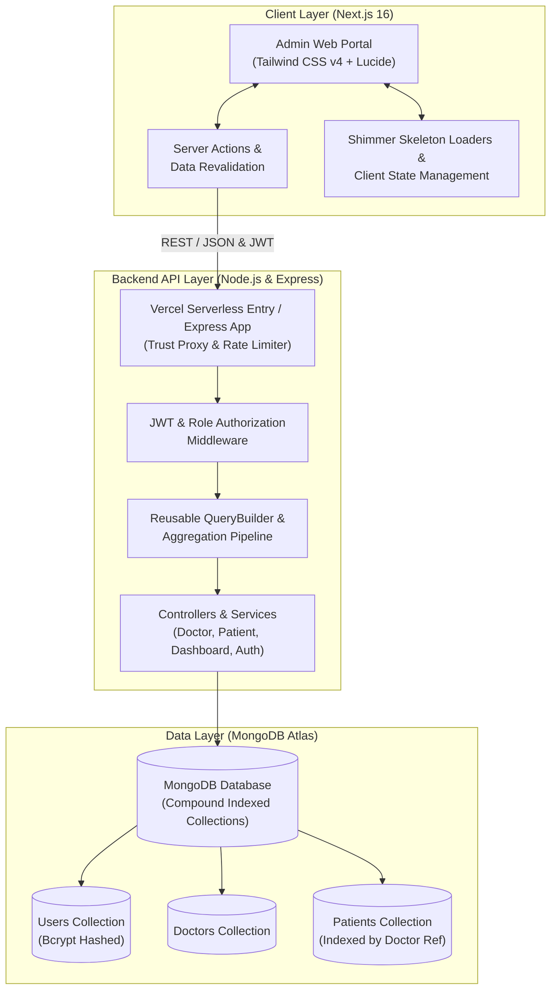

# Doctor Tracker — Healthcare Management Portal

[](https://nextjs.org/)
[](https://expressjs.com/)
[](https://www.typescriptlang.org/)
[](https://www.mongodb.com/)
[](https://tailwindcss.com/)

---

## 1. Description

**Doctor Tracker** is a secure, clinical-grade administrative web application designed for hospitals and healthcare systems to seamlessly monitor medical practitioners, track patient admissions, and manage clinical assignments. Built with an enterprise-ready decoupled architecture—featuring a Next.js 16 App Router frontend and a standalone Express.js REST API powered by MongoDB—the platform combines sub-millisecond query performance, rigorous role-based access control (RBAC), accessible micro-interactions, responsive data visualizations, and automated data aggregation.

---

## 2. Project Links & Credentials

- **GitHub Repository:** [https://github.com/Yead191/doctor-tracker](https://github.com/Yead191/doctor-tracker)
- **Live Frontend Portal:** `https://doctor-tracker-frontend.vercel.app` *(or your deployed URL)*
- **Live Backend API:** `https://doctor-tracker-backend.vercel.app` *(or your deployed URL)*

### Default Administrative Credentials
> [!IMPORTANT]
> The database automatically seeds the initial Super Admin account and comprehensive sample records upon initial startup.

| Role | Email | Password |
|---|---|---|
| **Super Admin** | `admin@doctortracker.com` | `Admin@123456` |

---

## 3. System Architecture

Doctor Tracker employs a decoupled full-stack architecture adhering strictly to RESTful design principles. The client interface communicates asynchronously with the dedicated API backend over HTTP/REST with JSON data models and multipart/form-data for media assets.



### Data Flow & Service Interactions
1. **Authentication Flow:** User submits credentials via the Next.js login portal. The Express backend validates credentials using Bcrypt, generates a signed JWT token, and returns user identity metadata stored securely via cookies.
2. **Clinical Aggregation Flow:** When accessing the dashboard, Next.js initiates server-side parallel fetching. The backend executes optimized MongoDB aggregation pipelines (`$facet`, `$group`, `$lookup`) to compute live statistics (total doctors, active patients, doctor-patient distributions, admission timelines) in a single round-trip.
3. **Data Mutation & Revalidation:** When an admin edits or deletes a doctor/patient, the request is executed against the REST API. Upon success, Next.js triggers `revalidatePath` across affected route caches (`/dashboard`, `/doctors`, `/patients`, `/doctors/[id]`, `/patients/[id]`), instantly synchronizing UI state without manual page reload.

---

## 4. Setup Guide

### Prerequisites
- **Node.js:** `v18.x` or `v20.x` or later
- **npm:** `v9.x` or later
- **MongoDB:** Local MongoDB instance (`mongodb://127.0.0.1:27017/doctor-tracker`) or MongoDB Atlas connection string
- **Git**

### Step 1: Clone the Repository
```bash
git clone https://github.com/Yead191/doctor-tracker.git
cd doctor-tracker
```

---

### Step 2: Backend Setup

1. Navigate to the backend directory and install dependencies:
   ```bash
   cd backend
   npm install
   ```

2. Create and configure your environment file:
   ```bash
   cp .env.example .env
   ```

3. **Backend Environment Variables (`backend/.env.example`):**
   ```env
   # Server Configuration
   NODE_ENV=development
   PORT=5000
   IP_ADDRESS=0.0.0.0
   PROJECT_NAME="Doctor Tracker Backend"

   # Database Connection (Local or MongoDB Atlas)
   DATABASE_URL=mongodb+srv://<username>:<password>@cluster0.pjwkg.mongodb.net/doctorTrackerDB?retryWrites=true&w=majority

   # Security & Authentication
   BCRYPT_SALT_ROUNDS=12
   JWT_SECRET=doctor_tracker_super_secure_jwt_secret_key_2026
   JWT_EXPIRE_IN=30d

   # Default Super Admin Seed Credentials
   SUPER_ADMIN_EMAIL=admin@doctortracker.com
   SUPER_ADMIN_PASSWORD=Admin@123456
   ```

4. Start the backend development server:
   ```bash
   npm run dev
   ```
   *The API will start on `http://localhost:5000`. On first run, it automatically connects to MongoDB, seeds the initial super admin account, and inserts realistic sample records for instant testing.*

---

### Step 3: Frontend Setup

1. Open a new terminal tab, navigate to the frontend directory, and install dependencies:
   ```bash
   cd frontend
   npm install
   ```

2. Create and configure your environment file:
   ```bash
   cp .env.example .env.local
   ```

3. **Frontend Environment Variables (`frontend/.env.example`):**
   ```env
   BASE_URL=http://localhost:5000/api/v1
   NEXT_PUBLIC_BASE_URL=http://localhost:5000/api/v1
   NEXT_PUBLIC_SERVER_URL=http://localhost:5000
   ```
   *(For live deployment, replace `http://localhost:5000` with your live backend API URL).*

4. Start the Next.js frontend development server:
   ```bash
   npm run dev
   ```

5. Access the application in your browser at `http://localhost:3000`. Login with the default credentials (`admin@doctortracker.com` / `Admin@123456`).

---

## 5. Technical Decisions

### Decision 1: Standalone Express.js REST Server vs. Next.js Route Handlers
- **Choice:** Built a completely decoupled Node.js + Express backend server communicating over standard REST endpoints rather than co-locating backend logic inside Next.js API route handlers.
- **Rationale:** 
  1. **Architectural Separation:** Adheres strictly to the requirement for a clear client-server boundary. This allows the backend and frontend to be scaled, tested, deployed, and containerized independently.
  2. **Dedicated Healthcare Pipeline:** Real-world hospital systems require fine-grained middleware control—including granular IP rate limiting, multipart chunked file upload streaming with Multer, Morgan request auditing, and Winston daily log rotation. Handling these within an independent Express service protects the UI layer from compute spikes during heavy data aggregation.
  3. **Multi-Client Readiness:** An independent REST API guarantees that future mobile applications (React Native / Flutter) or third-party hospital integration webhooks can consume the exact same endpoints without requiring Next.js runtime dependencies.

### Decision 2: Hybrid Server-Side Rendering (SSR) with Next.js 16 Cache Revalidation vs. Client-Side SPA Fetching
- **Choice:** Implemented Next.js App Router Server Components for initial data delivery combined with granular Server Actions (`revalidatePath`) and client-side optimistic UI synchronization.
- **Rationale:**
  1. **Zero Layout Shift & Rapid FCP:** Server-rendered clinical tables and statistics load immediately with zero blank screen flicker or client waterfall latency.
  2. **Automated Cache Purging:** When an admin creates, updates, or deletes a doctor or patient, Next.js invalidates the specific route cache paths (`/patients/[id]`, `/doctors/[id]`, `/dashboard`). This guarantees consistent, up-to-the-second clinical records across concurrent browser sessions without needing manual Redux/Zustand boilerplate or fragile polling loops.
  3. **Seamless UX with Skeleton Fallbacks:** Pairing SSR with React Suspense and custom shimmer skeletons (`loading.tsx`) provides feedback during cold data fetches, delivering an intuitive desktop and mobile experience.

### *(Bonus)* Decision 3: Custom Mongoose Compound Indexing and Reusable QueryBuilder
- **Choice:** Developed a modular `QueryBuilder` class and established compound indexing (`{ doctor: 1, createdAt: -1 }`, text indices on names/emails/specializations).
- **Rationale:** Prevents N+1 query overhead across paginated patient and doctor listings. Compound indexing guarantees sub-10ms retrieval times even as clinical logs expand, while standardized query builders ensure consistent pagination, sorting, search keyword matching, and ISO date-range filtering.

---

## 6. Visual Evidence

The platform is designed with a modern medical-grade aesthetic, high-contrast typography, micro-interactions, accessible modal dialogs, and adaptive mobile navigation.

### Key Application Views

| View | Description | Key Features |
|---|---|---|
| **Administrative Dashboard** | Real-time ecosystem overview | Live metric counters, Recharts-powered patient distribution charts, recent admissions feed, instant navigation shortcuts. |
| **Doctor Management** | Practitioner directory | Search by name/email/specialization, experience filter, active status toggle, add doctor modal, assigned patient counts. |
| **Doctor Detail Page** | Comprehensive doctor profile (`/doctors/[id]`) | Clinical summary stats, contact information, direct patient assignment modal, doctor patient roster table, inline deletion modal. |
| **Patient Management** | Full patient roster (`/patients`) | Filter by medical condition and admission date, multi-field search, pagination, inline status badges, attending physician badge. |
| **Patient Detail Page** | Dedicated clinical profile (`/patients/[id]`) | Quick health state switcher (Stable, Critical, Recovered), attending doctor card, clinical notes editor, direct physician contact helpers. |
| **Clinical Delete Modal** | Accessible confirmation modal | Replaces browser alerts with an accessible, branded modal warning before permanent record deletion. |
| **Shimmer Loading Skeletons** | Smooth loading states | Tailored shimmer skeletons across all routes for smooth transitions. |
| **Mobile Drawer Navigation** | Fully responsive UX | Mobile sidebar drawer, touch-friendly tables, and responsive cards for viewports from 320px to 4K displays. |

*(High-resolution screenshots are located in `/docs/screenshots/` and viewable directly in the live application).*

---

## 7. API Reference Overview

All REST API endpoints are prefixed with `/api/v1` and protected by JWT authentication headers (`Authorization: Bearer <token>`):

### Authentication (`/api/v1/auth`)
- `POST /auth/login` — Authenticate admin and receive JWT access token.
- `POST /auth/refresh-token` — Refresh expired session tokens.

### Doctors (`/api/v1/doctors`)
- `GET /doctors` — List all doctors (supports `page`, `limit`, `searchTerm`, `specialization`, `status`, `startDate`, `endDate`).
- `GET /doctors/:id` — Retrieve single doctor by ID with assigned patient list.
- `POST /doctors` — Create a new doctor with profile information and image upload.
- `PATCH /doctors/:id` — Update doctor record.
- `DELETE /doctors/:id` — Delete doctor record.
- `POST /doctors/:id/assign-patient` — Assign an existing patient to a doctor.
- `DELETE /doctors/:id/remove-patient/:patientId` — Remove patient assignment from a doctor.

### Patients (`/api/v1/patients`)
- `GET /patients` — List all patients (supports `page`, `limit`, `searchTerm`, `condition`, `status`, date filtering).
- `GET /patients/:id` — Retrieve comprehensive patient profile with attending doctor.
- `POST /patients` — Register new patient under an attending doctor.
- `PATCH /patients/:id` — Update patient records, condition, notes, or doctor assignment.
- `DELETE /patients/:id` — Delete patient record.

### Dashboard Analytics (`/api/v1/dashboard`)
- `GET /dashboard/stats` — High-performance aggregate metrics (total counts, condition breakdowns, 7-day admission velocity).

---

## 8. Deployment Guide

### Deploying Backend to Vercel
1. In MongoDB Atlas, ensure **Network Access** allows `0.0.0.0/0` (required for serverless dynamic IPs).
2. On Vercel, click **Add New Project** and select this repository.
3. Set **Root Directory** to `backend`.
4. Add environment variables (`DATABASE_URL`, `JWT_SECRET`, `NODE_ENV=production`, `SUPER_ADMIN_EMAIL`, `SUPER_ADMIN_PASSWORD`).
5. Deploy. Vercel will use [`backend/vercel.json`](file:///d:/Projects/doctor-tracker/backend/vercel.json) and [`backend/api/index.ts`](file:///d:/Projects/doctor-tracker/backend/api/index.ts) as the serverless function handler.

### Deploying Frontend to Vercel
1. On Vercel, click **Add New Project** and select this repository.
2. Set **Root Directory** to `frontend`.
3. Set Environment Variable: `NEXT_PUBLIC_BASE_URL=https://your-backend.vercel.app/api/v1`.
4. Deploy.

---

## 9. License & Authors
Developed for the Doctor Tracker Full-Stack Assessment.
Licensed under the ISC License.
